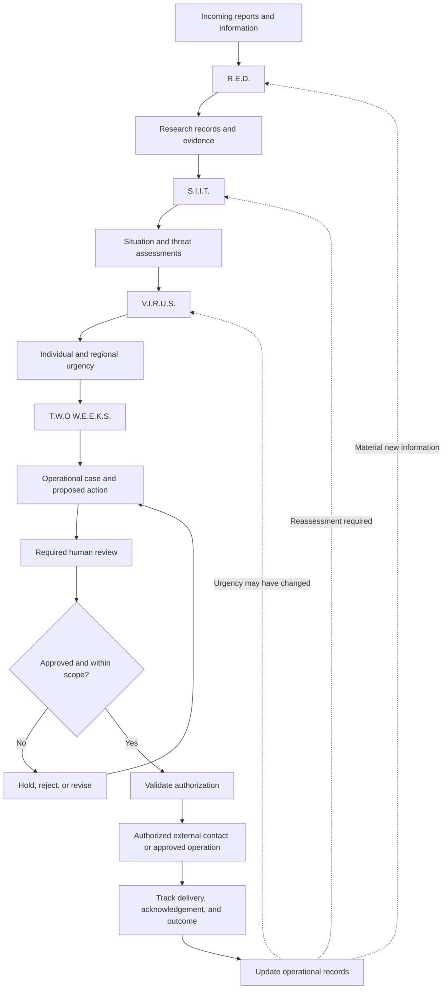
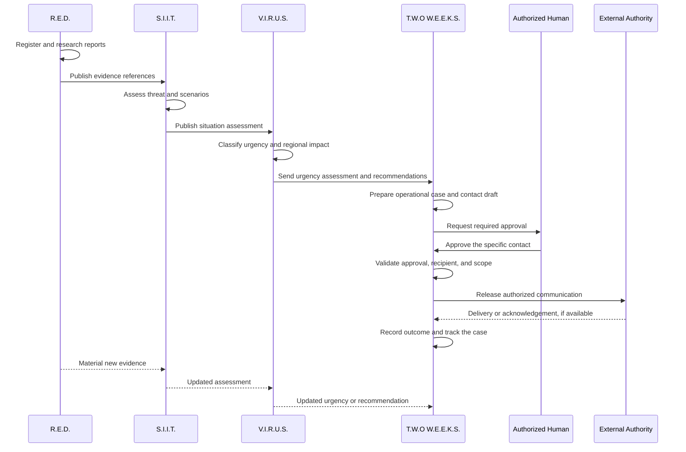
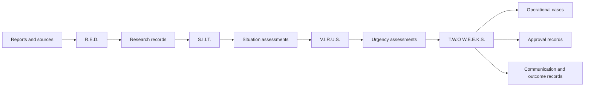
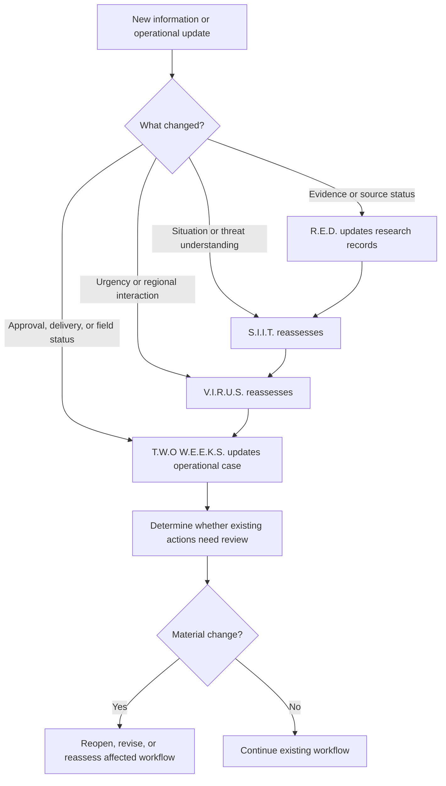

# G.R.O.A.
## Master Architecture, Module Relationships and Operational Flow

**Project:** G.R.O.A. — Threat Alert and Intelligence System  
**Document:** `INFO.md`  
**Status:** Architecture overview  
**Version:** 1.0

---

## 1. Introduction

G.R.O.A. is designed as a modular intelligence and operational coordination system that transforms incoming information into researched intelligence, interpreted situations, urgency assessments, and authorized operational actions.

Its architecture separates four responsibilities:

1. **R.E.D.** researches information and organizes evidence.
2. **S.I.I.T.** interprets situations, assesses threats, and develops scenarios.
3. **V.I.R.U.S.** classifies urgency, evaluates regional conditions, and prioritizes attention.
4. **T.W.O W.E.E.K.S.** coordinates operational workflows and authorizes the transition to external contact after the required human approval.

Each module has a distinct role. The system is designed so that information can move between modules without allowing one module to silently assume another module's responsibilities.

The guiding principle is:

> Research informs assessment. Assessment informs urgency. Urgency informs operational review. Authorized decisions govern real-world action.

This document provides the high-level view of how the modules interact. Detailed module-specific responsibilities are defined in:

- `RED.md`
- `SIIT.md`
- `VIRUS.md`
- `TWO-WEEKS.md`

The component names, data structures, and diagrams in this document describe the intended architecture. They must be reconciled with the actual repository and implementation.

## 2. The Four Modules at a Glance

| Module | Full name | Primary responsibility | Main question |
|---|---|---|---|
| R.E.D. | Researched Emerging Data | Research and evidence organization | What information is available, and how reliable is it? |
| S.I.I.T. | Situational Intelligence for Incoming Threats | Situation interpretation and threat assessment | What is happening, what threats may exist, and what could happen next? |
| V.I.R.U.S. | Verified Intelligence for Regional Urgency Situations | Urgency classification and regional prioritization | How urgent is it, what requires attention first, and why? |
| T.W.O W.E.E.K.S. | Threat Warning Operations for War Evacuations, Escalations and Keeping Safety | Operational coordination and authorization-gated external action | What should happen next, who must approve it, and what actually happened? |

### 2.1 A simple analogy

Think of G.R.O.A. as a coordinated emergency intelligence and operations team.

- **R.E.D. is the research desk.** It gathers information, checks sources, and organizes evidence.
- **S.I.I.T. is the analytical desk.** It develops an evidence-based understanding of situations and their potential threats.
- **V.I.R.U.S. is the prioritization desk.** It determines urgency and how situations affect the wider region.
- **T.W.O W.E.E.K.S. is the operations desk.** It coordinates reviews, verifies approvals, manages communications, and tracks operational outcomes.

These are functional distinctions, not necessarily separate servers, applications, or teams.

## 3. High-Level Architecture



The diagram shows the logical flow, not a mandatory synchronous execution sequence. Research, assessment, regional prioritization, and operational tracking may continue asynchronously as new information arrives.

A failed approval or validation must prevent the relevant consequential action from being released.

### 3.1 The critical boundary

The final decision is not made simply because an upstream module produces a particular result.

A Critical V.I.R.U.S. assessment can justify urgent review. It cannot independently authorize external contact or an evacuation.

T.W.O W.E.E.K.S. verifies that the required human approval exists and matches the action being proposed. Only then can the corresponding external action proceed through an authorized integration.

## 4. Module 1 — R.E.D.

### Researched Emerging Data

**Purpose:** Discover, receive, research, correlate, and organize information into traceable intelligence records.

R.E.D. is the system's information and evidence foundation.

### Inputs

- Incoming reports and submissions.
- Available information sources.
- Existing research records.
- Updates, corrections, and retractions.
- Requests for additional research.
- Information gaps identified by downstream modules.

### Processing

1. Receive or discover information.
2. Validate and register source metadata.
3. Research relevant claims.
4. Compare information from available sources.
5. Record provenance and verification status.
6. Identify possible relationships and evidence gaps.
7. Publish traceable research records.
8. Update or correct records when new information arrives.

### Outputs

- Research records.
- Evidence references.
- Source metadata and provenance.
- Claim-level verification states.
- Correlation candidates.
- Known limitations and information gaps.
- Research updates and corrections.

### Boundaries

R.E.D. does not independently determine the final threat classification, assign V.I.R.U.S. urgency, or authorize operational action.

A report being received does not mean that its claims are verified.

**Its output gives S.I.I.T. information to analyze, not a predetermined conclusion.**

## 5. Module 2 — S.I.I.T.

### Situational Intelligence for Incoming Threats

**Purpose:** Interpret researched information, build an understanding of situations, assess threats, and develop evidence-based scenarios.

S.I.I.T. turns information into structured analytical assessments.

### Inputs

- R.E.D. research records.
- Evidence and source references.
- Relevant historical context.
- Updates and corrections.
- Authorized reassessment requests.

### Processing

1. Validate incoming intelligence.
2. Build a structured picture of the situation.
3. Evaluate evidence quality, freshness, and contradictions.
4. Identify potential threats and relevant indicators.
5. Assess the current situation.
6. Develop forward-looking scenarios with assumptions and uncertainty.
7. Validate the assessment.
8. Publish a versioned assessment.
9. Reassess when material information changes or policy requires review.

### Outputs

- Situation assessments.
- Threat assessments.
- Supporting evidence references.
- Indicators and relevant changes.
- Forward-looking scenarios.
- Assumptions, uncertainty, and limitations.
- Version history and reassessment updates.

### Boundaries

S.I.I.T. interprets situations and assesses threats. It does not own the system-wide urgency classification or operational authorization process.

A possible future event must remain a scenario or forecast rather than being presented as a confirmed event.

**Its output gives V.I.R.U.S. an assessed situation to prioritize.**

## 6. Module 3 — V.I.R.U.S.

### Verified Intelligence for Regional Urgency Situations

**Purpose:** Classify individual urgency, aggregate regional conditions, identify interactions, and recommend appropriate review or response pathways.

V.I.R.U.S. converts analytical assessments into a prioritized view of what needs attention.

### Inputs

- S.I.I.T. assessments.
- Relevant R.E.D. evidence references.
- Geographic and temporal context.
- Updates, corrections, and assessment freshness information.
- Configured urgency policies.

### Processing

1. Validate input assessments.
2. Classify individual situation urgency.
3. Identify relationships between relevant situations.
4. Evaluate combined regional conditions.
5. Consider severity, time sensitivity, exposure, and dependencies.
6. Assess uncertainty and information freshness.
7. Recommend priorities and review pathways.
8. Publish versioned urgency assessments.
9. Reassess affected situations and regions when material changes occur.

### Urgency levels

| Level | Classification | General meaning |
|---|---|---|
| 1 | Routine | No elevated urgency established by the current assessment |
| 2 | Elevated | Increased attention is warranted |
| 3 | High | Prompt review is warranted |
| 4 | Very High | Serious, time-sensitive concerns warrant urgent review |
| 5 | Critical | Potentially severe, time-critical consequences warrant immediate authorized review |

Two separate assessment states are also required:

- **Unassessed:** No valid urgency classification has been completed.
- **Uncertain / Conflicted:** An assessment was attempted, but the evidence is insufficient, stale, or contradictory.

Neither state should be silently converted into Routine.

### Individual and regional urgency

V.I.R.U.S. assesses both individual situations and the aggregate regional picture.

Regional urgency is not simply an average of individual scores. A single severe incident may dominate regional concern, while several less severe incidents may combine into a more serious situation because they affect the same population, routes, infrastructure, or services.

### Boundaries

V.I.R.U.S. classifies urgency and recommends priorities or response pathways.

It does not independently contact authorities, publish warnings, or issue evacuation orders.

**Its output gives T.W.O W.E.E.K.S. a reasoned basis for operational review and prioritization.**

## 7. Module 4 — T.W.O W.E.E.K.S.

### Threat Warning Operations for War Evacuations, Escalations and Keeping Safety

**Purpose:** Coordinate warnings, escalation workflows, evacuation-related operations, human approvals, and authorized external contact.

T.W.O W.E.E.K.S. is the operational gateway between G.R.O.A.'s intelligence and the real world.

### Inputs

- V.I.R.U.S. urgency assessments and recommendations.
- S.I.I.T. assessments and supporting context.
- R.E.D. evidence references.
- Operational policies and authorization requirements.
- Verified recipient and communication-channel records.
- Human review and approval decisions.
- Incoming acknowledgements and operational updates.

### Processing

1. Create or update an operational case.
2. Identify the proposed action and its purpose.
3. Prepare a warning, authority contact, escalation, or evacuation-related workflow.
4. Validate the supporting information.
5. Route consequential actions for the required human review.
6. Record the decision and scope of approval.
7. Verify that the approval remains valid.
8. Confirm that the recipient, content, channel, and action match the approved scope.
9. Release the authorized action through an approved integration.
10. Track submission, delivery, acknowledgement, and operational outcomes.
11. Reopen or reassess the workflow when material information changes.

### Outputs

- Operational cases and status records.
- Warning drafts and approved versions.
- Human approval records.
- Authorized external contact events.
- Escalation records.
- Evacuation-related coordination records.
- Delivery and acknowledgement status.
- Operational updates and audit history.

### Boundaries

T.W.O W.E.E.K.S. cannot create real-world authority simply because an upstream module reports a serious threat.

It must not bypass required approval, invent recipients, or claim that a warning was delivered or an evacuation completed without supporting confirmation.

**Its defining responsibility is to control the authorized transition from internal assessment to external action and track what follows.**

---

## 8. Complete Scenario — A Fictional Flood Threat

The following is an illustrative scenario, not a real incident or an operational recommendation for any actual location.

Imagine that heavy rainfall has been reported near a fictional town called **Rivergate**. Several reports suggest that a river may be rising, and a bridge provides an important connection between nearby communities and a medical facility.

The reports are incomplete. It is not yet established whether the bridge is unsafe or whether an evacuation is necessary.

This scenario demonstrates how the four modules cooperate without taking over one another's responsibilities.

### Stage 1 — R.E.D. receives and researches reports

A local report states that the river is rising. Another report claims that water has reached the bridge approach. A third source provides a rainfall update.

R.E.D. registers the reports and records their origins, timestamps, and verification states.

It identifies that the reports concern the same area and may describe related developments. It also notes that the bridge's current condition has not been reliably established.

**R.E.D.'s result:**

- The reports are registered.
- Their sources and evidence references are recorded.
- The information is compared and organized.
- The bridge condition remains unconfirmed.
- The information is made available for situation assessment.

R.E.D. does not declare that the bridge has failed or order anyone to leave.

### Stage 2 — S.I.I.T. assesses the situation

S.I.I.T. consumes the research records and evaluates the possible flood threat.

It considers the available observations, the uncertainty surrounding the bridge, the area's exposure, and the possible consequences if the river continues to rise.

It develops a current situation assessment and may describe several possible scenarios:

- The river stabilizes and the bridge remains usable.
- Water levels rise further and the bridge approach becomes unsafe.
- Flooding disrupts access to the medical facility.

Each scenario includes its assumptions, evidence, time horizon where supportable, and uncertainty.

**S.I.I.T.'s result:**

- A versioned situation assessment.
- An evidence-grounded interpretation of the potential threat.
- Relevant scenarios and indicators to monitor.
- Clear documentation of what remains unknown.

S.I.I.T. does not treat the worst-case scenario as a confirmed event.

### Stage 3 — V.I.R.U.S. evaluates urgency

V.I.R.U.S. receives the S.I.I.T. assessment and relevant regional information.

It evaluates the urgency of the individual flood situation and considers the wider region, including the bridge's potential importance to access and essential services.

Suppose the evidence supports a **High** urgency classification. This is an illustrative result, not a fixed score dictated by the scenario.

V.I.R.U.S. recommends prompt review and continued monitoring of the bridge condition. It also records which changes could materially raise or lower urgency.

If a reliable update later confirms that the bridge approach is becoming unsafe and that critical access may be disrupted, V.I.R.U.S. can reassess the individual and regional picture.

**V.I.R.U.S.'s result:**

- An individual urgency classification.
- A regional assessment where relevant.
- Supporting rationale and evidence references.
- Recommended priorities and review pathways.
- Reassessment triggers for material developments.

V.I.R.U.S. does not contact emergency services on its own authority.

### Stage 4 — T.W.O W.E.E.K.S. opens an operational case

T.W.O W.E.E.K.S. receives the urgency assessment and creates an operational case for review.

It identifies that the potential disruption may require an authority to examine the situation. The module prepares a proposed notification with the relevant information and references.

Before the contact can be released, the workflow identifies the appropriate recipient through a verified contact record or approved integration.

The draft distinguishes confirmed observations from unverified claims and describes the uncertainty surrounding the bridge.

**T.W.O W.E.E.K.S.'s initial result:**

- An operational case is opened.
- The proposed contact and its purpose are recorded.
- The supporting assessment references are attached.
- The recipient and communication channel are validated.
- The draft is routed to the required human reviewer.

The external contact remains blocked while approval is pending.

### Stage 5 — Human review and authorization

An authorized human reviewer examines the case, the supporting intelligence, the proposed contact, and the intended recipient.

The reviewer may approve the proposed contact, reject it, or request changes.

For this fictional example, assume the reviewer approves the specific notification to the verified authority.

T.W.O W.E.E.K.S. records the approval and validates that it applies to the intended recipient, message version, and purpose.

The module now has permission to release **that approved contact**, subject to the applicable authorization rules and operational checks.

This approval does not automatically authorize a public warning or an evacuation order.

### Stage 6 — Authorized external contact

After the authorization checks pass, T.W.O W.E.E.K.S. releases the notification through the approved communication integration.

The system records the submission result.

If the connected service confirms delivery, the record is updated accordingly. If the authority acknowledges the contact, that acknowledgement is recorded separately.

If the delivery attempt fails, the workflow remains unresolved and follows the configured failure-handling process.

**Important distinction:** An approved contact is not proof that the authority received it, and receipt is not proof that the authority has taken action.

### Stage 7 — The situation changes

Later, R.E.D. receives a new report from a source that may provide relevant information about the bridge.

R.E.D. researches the report and updates the relevant records.

S.I.I.T. reassesses the situation if the new information materially changes its analysis.

V.I.R.U.S. evaluates the updated assessment and determines whether individual or regional urgency needs to change.

T.W.O W.E.E.K.S. identifies the existing operational cases that may be affected and determines whether their drafts, approvals, or planned actions require review.

If an approved communication needs a material change, the module obtains the required new approval before releasing the revised message.

The process continues until the situation is resolved, the operational cases are appropriately closed, or ongoing monitoring is transferred to the relevant process.

### Scenario summary



The sequence shows a single example path. A rejected approval, missing evidence, failed delivery, or a change requiring reassessment would follow an alternative path rather than automatically proceeding.

---

## 9. Data Flow Between Modules

Each module consumes structured outputs from upstream modules and publishes its own results.



### 9.1 Preserve references

Where possible, downstream records should reference upstream records by stable identifiers rather than copying large amounts of source information into each assessment.

For example:

- A S.I.I.T. assessment references relevant R.E.D. research records.
- A V.I.R.U.S. assessment references the S.I.I.T. assessments it evaluated.
- A T.W.O W.E.E.K.S. case references the urgency assessment and supporting information that motivated the workflow.
- An external communication references its operational case, approved content version, and approval record.

This makes it easier to trace conclusions back to their supporting inputs.

### 9.2 Versioning

Upstream records may change after downstream assessments or operational cases have been created.

Material changes should therefore trigger targeted reassessment or review rather than silently changing historical conclusions.

Historical records should preserve what was known and authorized at the time an action occurred.

### 9.3 Data contracts

Before implementation, each module boundary should define:

- Required fields.
- Identifier conventions.
- Valid states and enumerations.
- Timestamp conventions.
- Provenance requirements.
- Versioning behavior.
- Error and retry behavior.
- Authorization and access rules.
- Compatibility expectations.

The detailed module documents describe intended responsibilities. The actual data contracts must match the existing repository and storage architecture.

---

## 10. Reassessment and Feedback Loops

G.R.O.A. is not a one-way pipeline.

New information can change the interpretation of a situation, the urgency classification, or an operational decision.



### 10.1 Hybrid reassessment

The modules use a combination of event-driven updates, scheduled freshness checks, and authorized manual requests.

- **R.E.D.:** Researches new information, corrections, and identified evidence gaps.
- **S.I.I.T.:** Reassesses when material evidence or situation indicators change, or when policy requires review.
- **V.I.R.U.S.:** Reassesses affected individual and regional urgency when contributing assessments change, with scheduled freshness checks and authorized manual requests.
- **T.W.O W.E.E.K.S.:** Rechecks operational cases when relevant assessments, approvals, recipients, delivery status, deadlines, or operational conditions change.

A change in one region should not cause every unrelated region or operational case to be recomputed unnecessarily.

### 10.2 Do not silently reuse stale conclusions

If a critical input becomes stale, contradicted, or invalidated, downstream modules must evaluate whether their conclusions remain valid.

An old assessment may remain available as historical information, but it must not be presented as newly confirmed.

An approval may also need to be reconsidered if the facts, recipient, content, or scope of the proposed action change materially.

---

## 11. Responsibility and Authority Matrix

| Responsibility | R.E.D. | S.I.I.T. | V.I.R.U.S. | T.W.O W.E.E.K.S. |
|---|---|---|---|---|
| Research and organize information | Primary | Consumes | Consumes references | Consumes references |
| Record source provenance | Primary | References | References | References |
| Interpret situations | Supports with evidence | Primary | Consumes assessments | Consumes context |
| Assess threats | No final assessment role | Primary | Uses results | Uses results |
| Develop scenarios | Supports research | Primary | Uses relevant context | Uses approved information |
| Classify urgency | No | No | Primary | Consumes results |
| Aggregate regional urgency | No | Supplies assessments | Primary | Consumes results |
| Recommend response pathways | Research needs | Analytical findings | Urgency-based recommendations | Operational recommendations within scope |
| Prepare warnings | Supplies information | Supplies context | Supplies urgency context | Primary |
| Approve consequential external actions | No | No | No | Enforces and records required human approval |
| Authorize release after required approval | No | No | No | Primary workflow responsibility |
| Contact real-world authorities | No | No | No | Coordinates approved contact |
| Coordinate evacuation-related operations | No | No | Recommends urgency pathways | Primary |
| Track delivery and operational outcomes | No | No | No | Primary |
| Preserve module-level history | Research history | Assessment history | Urgency history | Operational and authorization history |

“Primary” means responsibility for that function within G.R.O.A. It does not override real-world legal authority or the responsibilities of external organizations.

---

## 12. Cross-Module Rules

The following rules apply across the architecture.

### Rule 1 — Evidence is not automatically fact

Information received by R.E.D. must retain its actual verification state.

Downstream modules must not silently upgrade its credibility.

### Rule 2 — Assessment is not certainty

S.I.I.T. must preserve uncertainty, assumptions, and conflicting evidence.

A forecast must not be treated as a confirmed event.

### Rule 3 — Urgency is not authorization

A V.I.R.U.S. classification can determine priority, but it cannot grant permission to contact authorities or issue an official instruction.

### Rule 4 — Recommendations are not orders

A recommendation from any module must remain distinguishable from an approved operational action.

### Rule 5 — Human approval has a defined scope

Approval applies to the action, recipient, content, and conditions actually reviewed.

Material changes may require renewed approval.

### Rule 6 — External actions require traceability

Consequential actions must be traceable to their rationale, supporting inputs, authorization, and release record.

### Rule 7 — Unknown outcomes remain unknown

The system must not infer successful delivery, acknowledgement, response, or evacuation from missing failure reports.

### Rule 8 — Failures must be visible

A failed module, integration, or reassessment must not silently produce a successful status.

### Rule 9 — AI assists but does not grant authority

Telvin can assist with analysis, summaries, and drafts. It cannot approve its own actions or bypass application-enforced authorization.

### Rule 10 — Changes propagate selectively

Only affected assessments, regions, and operational cases should be reconsidered when possible.

### Rule 11 — Historical records remain traceable

New versions must not silently erase the context in which an earlier assessment, approval, or action occurred.

### Rule 12 — Test environments must be isolated

Development and test workflows must not accidentally contact real authorities or publish real warnings.

---

## 13. Suggested Repository Organization

The following is an illustrative documentation layout, not a requirement to create new directories or move existing files.

```text
groa-alerts/
├── docs/
│   ├── info.md
│   ├── RED.md
│   ├── SIIT.md
│   ├── VIRUS.md
│   └── TWO-WEEKS.md
├── src/
│   ├── red/
│   ├── siit/
│   ├── virus/
│   └── two-weeks/
└── tests/
    ├── red/
    ├── siit/
    ├── virus/
    └── two-weeks/
```

If the repository already uses a different structure, preserve the existing conventions and place the documentation accordingly.

The master document should remain a high-level reference. Detailed business rules, data schemas, component contracts, and test expectations belong in their relevant module documentation or implementation files.

---

## 14. Implementation and Integration Checklist

Before treating the modules as an integrated system, verify the following.

### Architecture

- [ ] All four module responsibilities are clearly defined.
- [ ] Each module has explicit inputs and outputs.
- [ ] Module dependencies are documented.
- [ ] Existing services are reused where appropriate.
- [ ] Module boundaries are enforced in code rather than only in documentation.

### Data and traceability

- [ ] Shared identifiers and schemas are defined.
- [ ] Provenance and verification states are preserved.
- [ ] Assessments and consequential operational records are versioned.
- [ ] Upstream changes can identify affected downstream records.
- [ ] Unknown and stale states are represented accurately.

### Assessment and urgency

- [ ] S.I.I.T. separates current assessment from forecast scenarios.
- [ ] V.I.R.U.S. supports individual and aggregate regional urgency.
- [ ] Unassessed and Uncertain / Conflicted remain distinct from Routine.
- [ ] Regional assessment accounts for material interactions.
- [ ] Reassessment follows event-driven, scheduled, and authorized manual triggers.

### Operational authorization

- [ ] Consequential external actions require the defined human approval.
- [ ] Approvals are bound to a specific action and scope.
- [ ] Expired, revoked, or mismatched approvals block release.
- [ ] External recipients and channels are verified.
- [ ] Warning and evacuation workflows remain distinct from actual outcomes.
- [ ] Delivery and acknowledgement states reflect available evidence.

### Reliability and safety

- [ ] Duplicate events and retries are handled safely.
- [ ] Failures and unavailable dependencies are recorded.
- [ ] AI outputs are validated and cannot bypass authorization.
- [ ] Audit records support reconstruction of consequential actions.
- [ ] Test and production communication environments are isolated.
- [ ] End-to-end tests cover both successful and blocked workflows.

---

## 15. Final Mental Model

G.R.O.A. is best understood as a chain of increasingly consequential responsibilities.

**R.E.D. establishes what information is available.**

**S.I.I.T. determines what that information may mean.**

**V.I.R.U.S. determines how urgently the assessed situations require attention.**

**T.W.O W.E.E.K.S. determines how an approved operational response proceeds and whether G.R.O.A. is authorized to contact the outside world for the specific action.**

Each module adds a different kind of value. None should silently assume the responsibility of the next.

The complete system should make it possible to trace an external action back through its authorization, operational case, urgency assessment, threat assessment, and supporting research.

The objective is not simply to produce alerts. It is to create a traceable, reviewable, and responsibly coordinated process from incoming information to authorized action.

**G.R.O.A. — from researched information to assessed threats, prioritized urgency, and authorized operational coordination.**